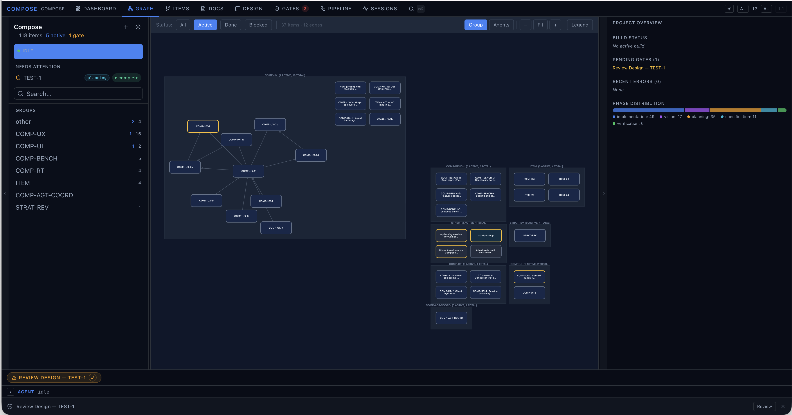

# Compose

### Structured AI dev pipeline: goal to shipped code, with gates that hold

#### *Your agent writes the code. Compose makes it prove it.*

> Describe what you want. Compose decomposes it, forces the design decisions before any code is written, hands each step to the right agent, and refuses to advance until that step proves it is done. What comes back is a feature folder with the design, the blueprint, the plan, the code, the tests, and the full review trail. Auditable end to end.



## The problem

An agent finishes, reports done, and the suite is green. Weeks later you find the feature. It exists, it has tests, and nothing calls it. The tests exercise a path that real data never enters.

Nobody lied. The agent did what it was asked, the tests assert what they assert, and no step in between ever had to prove the thing was wired to anything. That gap does not show up in a diff review. It shows up in production, or it never shows up at all, which is worse.

Compose sits above Claude Code, Codex, and Devin rather than in place of them. It decides what the next step is, hands it to whichever agent should do it, and will not advance until the step proves it finished.

## Who it's for

- **Solo builders and small teams** shipping more code each week than they can personally review, who need something other than trust to decide when a feature is really done
- **Tech leads reviewing agent output** who keep finding work that passes its own tests and is wired to nothing
- **Anyone running more than one agent** (Claude for implementation, Codex for review) who wants the same standard applied no matter which model did the work
- **Developers who lose the thread at a session boundary** and want the plan, the decisions, and the open questions to outlive the context window instead of living in chat scrollback
- **Maintainers whose roadmap has drifted from reality** and want status derived from what actually shipped rather than from what someone remembered to update
- **Teams who have to explain a decision months later**, what was chosen, what was rejected and why, and cannot reconstruct any of it from a diff

## Why Compose

| | Prompting the agent directly | A plan.md or TODO list | **Compose** |
| --- | --- | --- | --- |
| **Definition of done** | Whatever the agent says | A checkbox someone ticks | Postconditions checked before the step can pass |
| **Design decisions** | In the chat, then gone | Sometimes written down | Recorded artifacts, gated before any code |
| **Survives a session boundary** | No, only scrollback | The text, not the reasoning | Feature folder: design, blueprint, plan, review trail |
| **Review** | Whenever you remember | Manual | Enforced at every gate, and runnable on a different model than the one that wrote the code |
| **Catches wired-to-nothing code** | No | No | Implementation review keyed to wiring, not only to tests |
| **Roadmap status** | Manual | Manual, and it drifts | Generated from what actually shipped |
| **Recovery mid-build** | Start over | Re-read and guess | Resume from recorded state |

## How it holds the line

- **Gates everywhere.** Every phase transition (design, plan, ship) is approve, revise, or kill. Human or Codex review at any point.
- **Stratum-backed.** Pipelines are declarative `.stratum.yaml` specs with typed contracts, `ensure` postconditions, and retry/`on_fail` routing. Specs are editable.
- **Multi-agent.** Claude (via the Anthropic Agent SDK) Codex (via the OpenAI CLI), and Devin (via Stratum on macOS) plug in through a uniform connector interface. Reviews can run on a different model than implementation.

## Quickstart

### Prerequisites

- **Node.js 22.15 or newer.** `@smartmemory/stratum`, the engine Compose runs on, requires it (`node --version` to check).
- **git** (optional to start, needed for `compose hooks install` and for builds to commit their work: run `git init` in a new project first).
- **Claude Code** (`claude`) for the agent steps. The OpenAI `codex` CLI is only needed for Codex review steps, and a Devin-capable Stratum for Devin agents.
- Stratum needs no separate install: `@smartmemory/stratum` is a dependency, and `compose init` registers the installed copy's MCP entrypoint. Full prerequisites are in [docs/install.md](docs/install.md).

### Install

Pick one.

**From npm:**

```bash
npm install -g @smartmemory/compose
compose setup        # installs the bundled skills (alias: compose sync)
```

**From a clone** (for development):

```bash
git clone https://github.com/smartmemory/compose.git
cd compose
npm install
node bin/compose.js setup
mkdir -p ~/bin && ln -s "$(pwd)/bin/compose.js" ~/bin/compose   # optional: a bare `compose` command (needs ~/bin on your PATH)
```

The rest of this page writes `compose`. From a clone without the symlink, read it as `node /path/to/compose/bin/compose.js`.

### Start a project

```bash
mkdir my-project && cd my-project && git init
compose init                                      # writes .compose/, .mcp.json (compose and Stratum), ROADMAP.md, pipeline specs
compose feature AUTH-1 "JWT middleware with refresh tokens"
compose roadmap                                   # lists AUTH-1 as PLANNED
compose build AUTH-1                              # runs the lifecycle: this step calls a model
```

`compose new "what you want to build"` starts from a goal instead: it asks questions, researches, then writes the roadmap and feature folders.

At the end of a build, Compose prints each step's status, elapsed time, retries and recorded usage, plus totals for wall time, tokens and cost. Missing usage shows as `n/a`.

Check what you are running with `compose --version`, and diagnose a setup with `compose doctor` (missing optional skills are reported, not fatal).

## Commands

Every command in the dispatch, one line each (generated from `lib/cli-commands.js`, which a test keeps in step with `bin/compose.js`). `compose --help` prints the same list. Details are in [docs/cli.md](docs/cli.md).

**Getting started**

| Command | What it does |
|---|---|
| `compose init` | Initialize Compose in the current project |
| `compose setup` (also `sync`) | Install/sync global Compose skills |
| `compose install` | Legacy bootstrap, runs init + setup |
| `compose import` | Scan an existing project and generate a structured analysis |
| `compose doctor` | Check external skill dependencies |
| `compose preflight` | Cheap setup checks (engine, project checks), --gate wraps a test run |
| `compose update` (also `upgrade`) | Pull latest compose, reinstall deps, refresh global skill |

**Features & roadmap**

| Command | What it does |
|---|---|
| `compose new` | Kickoff a product (research, brainstorm, roadmap, scaffold) |
| `compose feature` | Add a single feature (folder, design seed, ROADMAP entry) |
| `compose roadmap` | Show roadmap status, generate/migrate/check ROADMAP.md |
| `compose triage` | Alias for `pipeline triage`: analyze a feature and recommend a build profile |
| `compose qa-scope` | Show affected routes from a feature's changed files |

**Build & implement**

| Command | What it does |
|---|---|
| `compose build` | Run a feature through the headless lifecycle (--preset fix\|plan for bugs and planning) |
| `compose fix` | Alias for `build --preset fix`: run a bug through the bug-fix lifecycle |
| `compose plan` | Alias for `build --preset plan`: plan work into a roadmap from a prompt |
| `compose gsd` | Alias for `pipeline gsd`: per-task dispatch from a blueprint + Boundary Map |
| `compose pipeline` | View and edit the build pipeline, runners: pipeline gsd \| experiment \| triage |
| `compose experiment` | Alias for `pipeline experiment`: run an A/B model experiment from a spec |

**Lifecycle, gates & review**

| Command | What it does |
|---|---|
| `compose gates` (also `gate`) | List and resolve pending gates |
| `compose loops` | Manage iteration loops for a feature |
| `compose guard` | Manage the canon guard and drift detection |
| `compose validate` | Validate feature/project artifacts against contracts |
| `compose record-completion` | Record a completion bound to a commit SHA (flips status to COMPLETE) |
| `compose verify` | Run the project's declared user flows (verify.flows), or --show what a completion proved |
| `compose lineage` | PROV-O artifact lineage: stamp \| stale \| show |
| `compose context` | Show the build decision log |

**Vision, ideas & tracking**

| Command | What it does |
|---|---|
| `compose items` | List vision items from local state (no server) |
| `compose ideabox` | Capture, review, and promote product ideas |
| `compose judgment` | Judgment records: trace a position's causal ancestry |
| `compose metrics` | Report dispatch, settlement, and triage metrics |
| `compose process` | Write the Process view pointer page (publish) |
| `compose tracker` | Tracker provider status and op-log sync |

**App, integrations & runtime**

| Command | What it does |
|---|---|
| `compose start` | Start the compose app (UI + API) for this project |
| `compose remote` | Manage remote access: pair, list, revoke, status |
| `compose smartmemory` | Sync feature-events/journal/artifacts into SmartMemory |

**Maintenance & info**

| Command | What it does |
|---|---|
| `compose migrate-state` | Run pending feature.json state migrations |
| `compose migrate-anon` | Promote anonymous ROADMAP rows to typed features (interactive) |
| `compose hooks` | Manage Claude Code hooks (install \| uninstall \| status) |
| `compose version` (also `--version`, `-V`) | Print compose version, git SHA, and install root |


## 30-second example

```bash
compose new "REST API for managing team todo lists"
  -> questionnaire (interactive)
  -> research (claude) -> brainstorm (claude)
  -> [gate] approve / revise / kill
  -> roadmap (claude) -> [gate] -> scaffold (claude)
  -> done: feature folders + ROADMAP.md ready

compose build TODO-1
  -> design (claude) -> [gate]
  -> blueprint (claude) -> verification (claude)
  -> plan (claude) -> [gate]
  -> decompose + parallel execute (worktree isolation)
  -> claude review lenses + codex review + coverage sweep
  -> docs + ship -> [gate]
  -> done: feature implemented, reviewed, tested, documented
```

As the build reports changed files, the terminal shows the first ten distinct paths in sorted order. The build summary includes the total file count.

Starting from a fuzzy goal instead of a known feature? Use the planning lifecycle:

```bash
compose plan "a tool that summarizes my team's standups"
  -> frame + research + ideate (ideas go to the ideabox) -> [gate]
  -> converge + estimate -> writes build-ready feature.json + design.md -> [gate]
  -> handoff: each feature ready for `compose build <CODE>`
```

`compose build` then picks up a plan-authored feature and ratifies its design rather than rewriting it.

Bundled [team presets](docs/team-presets.md): `feature` (parallel implementation),
`research` (parallel exploration), `review` (parallel review), and `fable-astra`:

```bash
compose build FEAT-1 --team fable-astra
```

Fable plans independent tasks, Codex workers implement in isolated worktrees, and
a fresh read-only Astra reviewer checks the merged result after verification.
Fable then requests another implementation or repair wave, declares the work
blocked, or approves ship into one base-parent commit. Concurrency is 3, the
$150 cost ceiling is overridable with `--cost-ceiling-usd`. See the
[loop and limits](docs/pipelines.md#fable-astra-wave-loop).

Per-agent choices, such as `--implementer=devin::fast` or `--route-mode=off`, are covered in [Routing and Devin](docs/routing-and-devin.md).

## Run the cockpit

The cockpit is the web UI. From a source checkout, `scripts/cockpit.sh start` runs the API server, the agent server and the Vite UI under `server/supervisor.js`, all bound to `127.0.0.1`, then waits until each port answers. Open `http://127.0.0.1:5195`. The ports are `PORT` (API, default 4001), `AGENT_PORT` (agent server, 4002) and `VITE_PORT` (UI, 5195).

```sh
scripts/cockpit.sh start    # pidfile + log in ~/.compose/run/
scripts/cockpit.sh status
scripts/cockpit.sh stop     # kills only the supervisor and its own children
```

It uses `node` and `python3` from your `PATH`. Set `PORT`, `AGENT_PORT` and `VITE_PORT` (or `COCKPIT_PORTS`) to move the ports, `COCKPIT_NODE` to pick a Node binary, and `COMPOSE_FLEET_PYTHON` for the optional fleet readers. Check a port is free first, for example `lsof -nP -iTCP:4001 -sTCP:LISTEN`. Do not click Run or Launch agent in the UI unless you mean it: the agent server spawns `claude -p`. From an npm install, `compose start` runs the same app for the current project.

### Wiki tab (`@smartmemory/wiki-components`)

The Wiki tab renders the SmartMemory wiki's feature hub, search, decisions, sources, area-docs and ledger screens (`^0.5.0`) from `@smartmemory/wiki-components` (a dev dependency, bundled into `dist/` at build time). The build uses the wiki checkout next to this repo when it exists (`../wiki/ui/packages/wiki-components`), else the installed package, else a stub that hides the tab, `COMPOSE_WIKI_COMPONENTS_DIR=<dir>` overrides and `none` forces the stub (`lib/wiki-components-link.js`). At runtime the tab shows only when the build has the package AND the project's `.compose/compose.json` has a `wiki` block (`{"enabled": true, "tokenEnv": "<ENV NAME>", "baseUrl": "http://127.0.0.1:8791"}`), without one the tab stays hidden. The build also checks that the package exports every screen the cockpit imports. A package that lacks one (the npm 0.6.0 package has no `Features`) is skipped with one WARNING and the tab is off. **The published npm package is built with `npm run build:package`, which turns the Wiki tab off** (`COMPOSE_WIKI_COMPONENTS_DIR=none`, one WARNING in the build log). A plain `npm run build` in a checkout still includes the tab when a complete package is found.

## Upgrading

One command, auto-detects whether compose was installed via npm or git clone:

```bash
compose update
```

Versions across the three published packages move together: `@smartmemory/compose-mcp` carries
compose's exact version, and `@smartmemory/compose` shares a minor with `@smartmemory/stratum`
(patches move independently). So compose 0.4.x pairs with stratum 0.4.x. See
[.claude/rules/versioning.md](.claude/rules/versioning.md).

For npm installs, this runs `npm install -g @smartmemory/compose@latest`. For git clones, it runs `git pull --ff-only && npm install`. Either way it then refreshes the global skill and (if invoked from inside a Compose project) re-runs `compose init` to refresh `.mcp.json` and pipeline templates. Use `compose update --force` to bypass the dirty-tree check on git clones.

Check what you're running:

```bash
compose --version
```

## Code graph (optional)

When a capable SmartMemory is installed, Compose indexes your code and uses the graph at two points in a build:

- **Before design (`explore_design`):** a "Possible Prior Art" block lists existing functions and classes that match the feature, with `file:line`, so the design starts from what already exists.
- **At the plan gate (`plan_gate`):** a reality check labels every backticked name and path in the plan as existing, new (marked `(new)`), unmarked-new (absent and not marked), or unknown (a path to a file the indexer skipped, or any absent name when the indexer ran out of its entity budget, so absence proves nothing). An absent symbol while some files were skipped stays unmarked-new, with the note "may be in N skipped file(s)". The result is shown in the gate summary and recorded under `.compose/codegraph/reality/`.

It is **warn-only**: it never blocks or decides a gate, and without SmartMemory it prints one warning and does nothing.

- **Producer.** The `smartmemory code bundle` CLI, version 1.5.26 or newer: `pip install 'smartmemory>=1.5.26'`. **1.5.25 is broken** (it segfaults on TypeScript repos) and is refused, as is anything older or a CLI without `code bundle`. Compose finds the CLI in this order: `"codegraph": { "smartmemory": "…" }` in `.compose/compose.json` (a path, relative to the project, or a command name), then `$COMPOSE_CODEGRAPH_SMARTMEMORY`, then `smartmemory` on `PATH`. Each run's stderr goes to `.compose/codegraph/<repo>/producer.log`, the console gets one summary line per run.
- **JS/TS needs the tree-sitter grammars.** `tree-sitter-typescript` and `tree-sitter-javascript` are not installed with smartmemory 1.5.26, install them into the same environment. Without them JS/TS files are skipped (`grammar_unavailable`): the reality check reports a path to such a file as unknown, not missing, and an absent symbol as unmarked-new with the note "may be in N skipped file(s)", since it cannot tell which file a symbol would live in.
- **Repos and timeout.** `codegraph.repos` in `.compose/compose.json` lists what to index (`[{ "name": "compose", "root": "." }, { "name": "stratum", "root": "../stratum/ts" }]`, default: the project root). `codegraph.timeoutMs` bounds one producer run.
- **Prebuild.** A build whose pipeline has `plan_gate` or `explore_design` starts the snapshots in the background at build start, so the gate usually hits the cache. Snapshots are cached in `.compose/codegraph/` (gitignored). A cached snapshot is reused only while git HEAD is unchanged, every file `git status` lists under the repo (ignored files, submodules and symlink targets included, `.compose/` excluded) is unchanged, and every resolution dependency SmartMemory recorded in the snapshot (`source.resolution_dependencies`: files, directory listings, globs, inside or outside the repo) still holds. Compose does not copy SmartMemory's read rules, so it errs toward rebuilding: a commit or an edited doc also rebuilds, a run in which a file changed in the last 3 seconds is used but not cached, and installing or removing a Python package beside the `smartmemory` CLI (a parser grammar, say), or putting `node` on or off `PATH`, also rebuilds. Touching a tracked file (or a checkout that rewrites it) rebuilds once, even when git says it is clean.
- **Disable** with `COMPOSE_CODEGRAPH=0` or `"codegraph": { "enabled": false }`. It is also off under `NODE_ENV=test` unless `COMPOSE_CODEGRAPH=1`.

## Jev gate defaults (optional)

At a review gate, Compose suggests a default answer, approve or revise, that you accept by pressing Enter. Without Jev, a keyword rule reads the step's summary and picks that default. It is often wrong: it misses steps that report a problem, and it flags clean summaries that happen to contain words like "error" or "missing".

[Jev](https://typesafe.ai), from TypeSafe, can pick the default instead. In our test on 51 real gate summaries, Jev matched a strong reference model on 45 of them, against 30 for the keyword rule.

- **Turn it on** by signing up at [typesafe.ai](https://typesafe.ai) and exporting your key: `export JEV_API_KEY=...`. It is on whenever the key is set. Nothing else to configure.
- **What you see.** The gate's recommendation ends with `(default by jev)` or `(default by keyword)`, so you always know which one picked it. You still decide. Jev only changes which answer Enter accepts.
- **What it sends.** Only when Stratum provides a step summary, Compose sends that summary text to `api.typesafe.ai`. Nothing else from your project leaves the machine. If that is not acceptable for a project, turn Jev off there.
- **Fallback.** Each call has a 1.5 second budget. On a timeout, an error or an unexpected answer, Compose uses the keyword rule and prints one warning per kind of failure.
- **Proxies.** Compose honors `HTTPS_PROXY` / `https_proxy` and `NO_PROXY` / `no_proxy`, and keeps one connection open between gates so later gates answer faster.
- **Turn it off** with `COMPOSE_GATE_JEV=0`. With no key, Jev stays off silently. Setting `COMPOSE_GATE_JEV=1` without a key prints one warning, which helps when you expected it to be on.
- **Tests.** Under `node --test` or Vitest, Jev stays off even when the key is exported, so a test run never makes paid calls.

## Bundled skills

`compose setup` (alias `compose sync`) mirrors compose-owned skills into your agent skill dirs (`~/.claude/skills/`, shared with Codex). Re-run it after a `compose update` or after editing skills locally, it's idempotent.

- **`/compose`**, the build/fix lifecycle orchestrator (idea → design → blueprint → implement, or triage → fix → verify).
- **`/context-budget`**, read-only audit of the session-start loaded surface (agents, skills, rules, MCP tool schemas, CLAUDE.md chain). Estimates per-component token cost, classifies each into always / sometimes / rarely needed, and prints a ranked cut list with estimated reclaim. Never auto-applies cuts.

`compose update` fetches a newer compose (npm or git) and then runs setup for you, use `compose sync` when there's no new version to pull, you just changed skills locally.

## Tracker providers

Compose can persist feature data to different backends via the `tracker` block in `.compose/compose.json`.

**Default (local), zero configuration required:**

```json
{ "tracker": { "provider": "local" } }
```

`local` is the default when no `tracker` block is present. All writes go to the filesystem exactly as before, no behavior change.

**GitHub provider:**

```json
{
  "tracker": {
    "provider": "github",
    "github": {
      "repo": "owner/repo",
      "projectNumber": 42,
      "branch": "main",
      "roadmapPath": "ROADMAP.md",
      "changelogPath": "CHANGELOG.md",
      "cacheTtlSeconds": 300,
      "auth": { "tokenEnv": "GITHUB_TOKEN" }
    }
  }
}
```

The GitHub provider syncs features to **Issues** (one per feature), **Projects v2** (`Status` custom field), and **Contents API** (roadmap + changelog files). Requires a token in the named env var (or `gh auth login` fallback) with `repo` and `project` scopes.

CLI verbs:

```bash
compose tracker status   # show provider health + pending op-log + conflict ledger
compose tracker sync     # reconcile op-log against remote provider
```

See [docs/configuration.md](docs/configuration.md) for the full `tracker` config reference.

## Backfilling a completion (guarded workspaces)

Sometimes a feature is finished before its lifecycle was ever walked: it shipped before Compose existed, or the guard was switched off at the time. Compose can record that completion with evidence instead of an override token. Call the MCP tool `backfill_completion` (or `POST /api/vision/items/:id/lifecycle/backfill`) with the completing commit, a test attestation, a reason, and dated phase occurrences. The gate verifies the evidence, merges the occurrences into the phase history by their real dates, and moves the guard to `complete_backfilled`. Readers and the UI show which entries were backfilled.

Features that were never registered with the guard need nothing else. Features registered before this release carry an older policy, and the guard will only accept the new one under a signed upgrade descriptor. The signature is the one thing an agent must never be able to produce on its own, so it is the one thing a human confirms:

- **Once per Mac:** run `compose guard enrol` from a terminal. It installs a root-owned signing key and signer under `/Library/Compose/guard/`, a `sudo` rule that always re-authenticates (Touch ID via `pam_tid`), enrols the public key in stratum's trust root, and verifies the round trip. Two Touch ID prompts, then `done`.
- **Every later signature is one Touch ID prompt.** When a backfill needs a descriptor that is not yet signed, the gate generates it, asks, verifies, and continues. Nothing else is manual. `compose guard sign` does the same explicitly and `compose guard status` shows custody, enrolment, descriptor freshness and whether the signed generations are committed.

Signed descriptors live in `.compose/guard-upgrades/<sha256>/` (immutable) with `current` pointing at the live generation, commit them like any other workspace canon. A backfill refuses with `signature_not_approved` when the prompt is cancelled or cannot be shown (SSH session, `tmux` without `pam_reattach`), and with `upgrade_descriptor_unavailable` on a machine that has not run `enrol`. Admins who want the "one approval, one signature" property to hold against their own other `sudo` use can add `Defaults timestamp_timeout=0` to sudoers. Without macOS custody (Linux, CI), `compose guard descriptors` still writes the unsigned candidate and prints the `ssh-keygen -Y sign` command for an operator key.

**Minting a receipt.** A state claim (`LANDED`, `DONE`, ...) quotes an `ev:<id>` the server has re-checked: from MCP call `record_evidence` with an `evidence` object and a `subject` (`unit` or `feature`, plus `claim`), from a shell run `node lib/evidence-cli.js record '<evidence json>' --subject '<subject json>'`. Both print the id and store the same record (`~/.compose/evidence.jsonl`), implementer and reviewer profiles cannot call the MCP tool.

## Remote access (mobile PWA from anywhere)

The mobile cockpit at `/m` can be reached from outside localhost, bring your own tunnel, compose handles auth and pairing:

```bash
npm run build                                  # source checkouts only; the npm package already ships dist/
COMPOSE_REMOTE_AUTH=enabled compose start --host=0.0.0.0
compose remote pair --public-host=https://your-tunnel-host   # prints a QR, scan it with your phone
compose remote status                          # bind, devices, tunnel reachability
```

How it works: binding beyond `127.0.0.1` refuses to start unless `COMPOSE_REMOTE_AUTH=enabled` is set. In remote mode every request needs a credential, there is deliberately **no IP-based trust** (tunnel daemons connect from loopback). Phones pair once via QR (5-minute single-use code) and stay authenticated for 30 days through rotating refresh tokens + 15-minute access JWTs, reuse of a rotated refresh token revokes the device. Devices are listable and revocable (`compose remote list|revoke`, or the cockpit's "Pair mobile" modal). Only port 4001 needs to be exposed, agent-server traffic is proxied through it.

Tunnel layer is yours: Tailscale (serve/funnel), Cloudflare Tunnel, or a reverse proxy on your own VPS+domain all work, the last is the most reliable from restrictive networks (e.g. mainland China, where `trycloudflare.com`/ngrok domains are commonly blocked, plain TLS on 443 to an unremarkable domain travels best). Pair the device *before* traveling: pairing needs a live round-trip, while an already-paired phone only needs refresh.

`compose remote rotate-secret --yes` invalidates every paired device (post-leak hammer).

## SmartMemory coupling (opt-in)

Compose can feed its own lifecycle history (feature events, gate decisions, journal entries,
artifacts) into [SmartMemory](https://github.com/smartmemory) for relevance-ranked recall,
via a `smartmemory` block in `.compose/compose.json`:

```json
{
  "smartmemory": {
    "enabled": true,
    "baseUrl": "http://localhost:9001",
    "apiKeyEnv": "SMARTMEMORY_API_KEY",
    "timeoutMs": 3000
  }
}
```

`smartmemory` is absent by default, which means the coupling is fully off: no probes, no
network calls, no new log lines. With `enabled: true` and a reachable SmartMemory service,
compose ingests lifecycle events live (fail-open) and the cockpit gains a Recall tab on each
feature's detail panel.

```bash
compose smartmemory sync                 # idempotent backfill of events, journal, artifacts
compose smartmemory sync --dry-run       # preview counts without ingesting
compose smartmemory sync --feature CODE  # scope the sync to one feature
```

### Maya colleague panel (opt-in, requires the SmartMemory service stack)

With the SmartMemory fluid provider configured, a `maya` block summons Maya (the SmartMemory
assistant) as a colleague inside the cockpit: a slide-over panel where you discuss ideas while
Compose computes the memory findings (challenge, conviction, contradictions) and hands them to
her as per-turn context. Her replies about a focused idea append to its discussion trail as
`author: maya`.

```json
{
  "maya": {
    "baseUrl": "http://localhost:9005",
    "auth": { "mode": "provision" }
  }
}
```

`auth.mode` is `provision` (a dedicated colleague identity minted lazily against the local
smart-memory-service test surface) or `static` (paste a token in the panel, it is verified
against the service before being stored). The colleague never runs degraded: without the
SmartMemory provider the panel explains what to connect instead of falling back to plain chat,
and capabilities the provider does not declare render as visibly unavailable.

## Documentation

Topic-scoped reference:

- [docs/install.md](docs/install.md), prerequisites, `compose init`, `compose setup`, `~/bin` symlink, `compose install` compatibility shim.
- [docs/cli.md](docs/cli.md): the full command index plus deep-dives for the main verbs.
- [docs/routing-and-devin.md](docs/routing-and-devin.md): shadow model routing and explicit Devin agents.
- [docs/cockpit.md](docs/cockpit.md), web UI shell: zones, graph view, context panel, ops strip, agent bar, persistence.
- [docs/pipelines.md](docs/pipelines.md), kickoff and build pipelines, sub-flows, contracts, `on_fail` routing, Stratum IR v0.3.
- [docs/agents.md](docs/agents.md), agent connectors, message envelope, Claude/Codex/Opencode connectors, registry.
- [docs/lifecycle.md](docs/lifecycle.md), questionnaire, gate system, validation, recovery, progress logging, vision tracker, result normalization.
- [docs/configuration.md](docs/configuration.md), `.compose/*.json`, pipeline specs, `.mcp.json`, `ROADMAP.md`, environment variables.
- [docs/mcp.md](docs/mcp.md), MCP server tool list (vision, lifecycle, gates, iteration loops).
- [docs/examples.md](docs/examples.md), worked workflows and the full `compose pipeline` editing reference.
- [docs/command-flows.md](docs/command-flows.md), mermaid flow diagrams for every CLI verb (`build`, `fix`, `gsd`, `new`, `import`, `feature`, `roadmap`, `triage`, `qa-scope`, `pipeline`, `init`/`setup`/`update`/`doctor`).

### Specs and design

- [docs/PRD.md](docs/PRD.md)
- [docs/PRODUCT-SPEC.md](docs/PRODUCT-SPEC.md)
- [docs/ROADMAP.md](docs/ROADMAP.md)
- [docs/taxonomy.md](docs/taxonomy.md)
- [docs/compose-one-pager.md](docs/compose-one-pager.md)

## License

[Business Source License 1.1](LICENSE), licensed by Regression Analytics LLC. Free for non-production use by anyone, and for production use by organizations whose total annual revenue (with affiliates) was USD 1,000,000 or less in their last fiscal year. Larger organizations need a commercial license: help@smartmemory.ai. Each version converts to Apache 2.0 four years after its release.

Versions released before 2026-09-25 were distributed under the MIT License and remain available under those terms. See [NOTICE](NOTICE).
